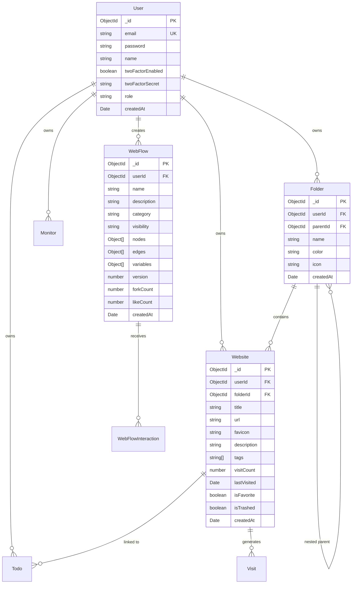

# WeSite — Project Context & Architecture Reference

> **WeSite** is an intelligent, visual bookmark organizer, website management suite, and autonomous workflow builder inspired by the macOS Finder and refined with a mild neo-brutalist design system.

---

## 1. Executive Summary & Core Mission

Modern web workers, researchers, and developers navigate dozens of tools every day. Traditional browser bookmarks are static, cluttered, and disconnected from the actions users actually take on websites.

**WeSite transforms bookmarks into an active operating system for the web:**
1. **macOS Finder Organization**: Deep nested folder hierarchies, color tags, favorites, visit tracking, and trash recovery.
2. **Chrome Extension Companion**: Instant 1-click bookmark capture, automatic metadata scraping (title, description, favicon, OpenGraph image), and folder routing directly from the browser tab.
3. **WebFlow Visual Orchestration**: An interactive node-based canvas (built with `@xyflow/react`) that turns saved websites and actions into executable workflows, complete with real-time animated flow simulation and multi-format exports for autonomous AI agents (Claude, LangChain, AutoGPT, OpenAI).
4. **Productivity & Intelligence**: Integrated task management (Todos attached to websites), website uptime & latency monitoring, curated tech news feeds, and comprehensive browsing analytics with activity heatmaps.

---

## 2. Tech Stack & Engineering Specifications

| Layer | Technologies | Details & Versions |
|---|---|---|
| **Framework** | Next.js 16 (App Router) | Version `16.2.10` with Turbopack bundler |
| **Runtime & Language** | Node.js + TypeScript 5 | Strict TypeScript typing (`tsc --noEmit` verified) |
| **UI & Styling** | React 19 + Tailwind CSS v4 | React `19.2.4`, `@tailwindcss/postcss` v4, CSS variables |
| **Icons & Micro-UI** | Lucide React + Sonner | `lucide-react` v1.24, `sonner` v2.0 for toast alerts |
| **Canvas & Graph Engine** | ReactFlow (`@xyflow/react`) | Version `^12.12.0` with custom nodes and labeled edges |
| **Database & ODM** | MongoDB 5.0+ with Mongoose | Mongoose `^9.7.4` with connection caching |
| **Authentication & 2FA** | JWT + Bcrypt + TOTP | `jsonwebtoken`, `bcryptjs`, `otplib` (RFC 6238), `qrcode` |
| **Third-Party Auth** | Google OAuth | `google-auth-library` verification |
| **Metadata Scraper** | Cheerio | Fast server-side HTML scraping for title, favicon, OG image |
| **Data Visualization** | Recharts | Version `^3.9.2` for visit trend lines, pie, and bar charts |
| **Validation & Schema** | Zod | Version `^4.4.3` for strict input validation |
| **Browser Extension** | Chrome Manifest V3 | Vanilla JS, background service worker, Chrome Storage API |

---

## 3. Design System & Aesthetic Language

WeSite employs a **mild neo-brutalist / macOS Finder** design language:
- **Geometry**: `rounded-2xl` and `rounded-3xl` cards, generous padding, crisp border geometry (`border-2` and `border-3`).
- **Color Tokens (CSS Variables)**:
  - `--nb-bg`: Main app canvas background (`#f8fafc` in light, `#090d16` in dark).
  - `--nb-card`: Component surface background (`#ffffff` in light, `#111827` in dark).
  - `--nb-border`: High-contrast structural boundary (`#0f172a` in light, `#334155` in dark).
  - `--nb-shadow`: Distinctive solid drop-shadow (`4px 4px 0px 0px var(--nb-border)`).
- **Transitions & Interactions**:
  - Tactile press feedback (`active:translate-y-0.5`).
  - Subtle hover lift (`hover:-translate-y-0.5 hover:shadow-nb-md transition-all`).
  - Animated edge energy lines on canvas (`@keyframes nb-edge-flow`).
  - Pulsing execution indicators and status badges (`@keyframes nb-glow-pulse`).

---

## 4. Key Feature Modules

### 4.1. Dashboard & Finder Workspace (`/`, `/dashboard`)
- **Dual View Modes**: Finder-style folder tree sidebar combined with a clean multi-column card grid or compact list view.
- **Nested Folder Hierarchies**: Arbitrary folder nesting with color-coded folder icons.
- **Card Controls**: Direct visit trigger (with automatic timestamp/counter increment), favorite toggle, tag chips, and dropdown actions (edit, move, trash).
- **Search & Filter**: Real-time client-side search across title, URL, tags, and description.
- **Global Command Palette**: Instant navigation and quick actions invoked with `⌘K` / `Ctrl+K`.

### 4.2. WebFlow Visual Workflow Builder (`/webflow`, `/webflow/[id]`)
- **Node-Based Canvas**: Drag-and-drop or 1-click insertion of workflow blocks:
  - `startNode`: Workflow triggers (manual, cron schedule, webhook).
  - `websiteNode`: Target websites integrated with user bookmarks and metadata.
  - `actionNode`: Deterministic execution steps (scrape, click, fill form, extract table).
  - `aiNode`: AI reasoning & synthesis steps with configurable system prompts and models.
  - `conditionNode`: True/False decision branching handles.
  - `transformNode`: Data formatting, filtering, and mapping.
  - `delayNode`: Timers and wait steps.
  - `noteNode`: Canvas documentation blocks.
  - `outputNode`: Results, webhooks, notifications, or exports.
- **Interactive Flow Simulation ("Test Flow")**:
  - Live simulation runner (`⌘↵`) that walks the graph step-by-step.
  - Nodes illuminate sequentially with animated state badges (`running` ➔ `success`).
  - SVG connection lines flow with animated energy particles.
  - Floating simulation monitor with live progress counter and cancellation.
- **Beginner Quick-Start Hub**:
  - Solves empty-canvas drop-off with 3 instant 1-click starter blueprints:
    1. *Standard Web Flow* (Trigger ➔ Source Website ➔ Extract Action ➔ Save Digest).
    2. *AI Agent Pipeline* (Query Trigger ➔ Research Target ➔ AI Reasoning ➔ Deliver).
    3. *Blank Slate* (Trigger block positioned for custom connection).
- **Floating Quick-Action Bar**:
  - Clicking any node provides `+ Next Step` and `+ AI` buttons to spawn and connect steps in one click.
- **AI Agent Export**:
  - Generates ready-to-use specifications in JSON, Markdown, YAML, LangChain, and Python formats.
- **Interactive Human Guide**:
  - Produces step-by-step markdown documentation for team handoffs.

### 4.3. Chrome Browser Extension (`extension/`)
- **Manifest V3 Architecture**:
  - `popup.html` / `popup.js`: Quick bookmark interface showing active tab details.
  - `background.js`: Background worker handling badge updates and cross-origin calls.
- **Direct Bookmark Capture**: Scrapes title, URL, and metadata from active tab in real time.
- **Folder Selector**: Allows filing directly into existing WeSite folders without opening the dashboard.
- **WebFlow Integration**: Direct button to attach the current tab as a node in an active WebFlow.
- **Sync**: Authenticates via stored session token communicating with WeSite REST APIs.

### 4.4. Website Monitoring (`/monitoring`)
- Real-time uptime monitoring for critical bookmarks.
- Tracks HTTP status codes, latency/response time graphs, and last-checked timestamps.
- Manual "Check Now" trigger and periodic background checking API (`/api/monitors/check`).

### 4.5. Tech News Hub (`/news`)
- Aggregates curated feeds from top technology sources (Hacker News, TechCrunch, GitHub Trending, etc.).
- Categorized tabs (Development, AI, Startups, Design).
- One-click "Save to WeSite" action to convert articles directly into bookmarks.

### 4.6. Task & Todo Management (`/todo`)
- Link tasks directly to specific websites or folders.
- Due dates, priority levels (Low, Medium, High, Urgent), and completion status.
- Filter by pending, completed, or website association.

### 4.7. Analytics & History (`/analytics`, `/history`)
- **Activity Heatmap**: GitHub-style calendar tracking daily browsing activity and bookmarks created.
- **Visit Trends**: Interactive line charts showing volume over time.
- **Top Websites**: Bar charts ranking most frequented tools.
- **Folder Distribution**: Pie chart illustrating bookmark distribution across categories.
- **Detailed Audit History**: Tabular view of all visits with timestamps and device metadata.

### 4.8. Authentication & Account Security (`/login`, `/register`, `/settings`)
- JWT-based authentication stored in secure `httpOnly` cookies.
- Password hashing using `bcryptjs` (salt rounds: 12).
- **Two-Factor Authentication (2FA/TOTP)**:
  - Standard authenticator app support (Google Authenticator, Authy, 1Password).
  - Setup with QR code display and backup recovery codes.
- **Google OAuth**: Fast login via Google Sign-In.
- Profile management, theme customization, and full account data export/import.

---

## 5. Directory & File Structure

```
wesite/
├── app/                                    # Next.js App Router
│   ├── layout.tsx                          # Root layout with ThemeProvider, Toaster, Metadata
│   ├── page.tsx                            # Root landing page / redirect to dashboard
│   ├── globals.css                         # Global CSS, Tailwind v4, neo-brutalist variables
│   ├── not-found.tsx                       # Custom 404 page
│   ├── global-error.tsx                    # Error boundary
│   │
│   ├── (auth pages)/
│   │   ├── login/page.tsx                  # Sign in (Email, Password, 2FA prompt, Google)
│   │   ├── register/page.tsx               # Account creation
│   │   ├── forgot-password/page.tsx        # Password reset request
│   │   └── reset-password/page.tsx         # Token-based password reset
│   │
│   ├── dashboard/page.tsx                  # Main Finder bookmark workspace
│   ├── analytics/page.tsx                  # Analytics & heatmap dashboard
│   ├── history/page.tsx                    # Chronological visit history
│   ├── monitoring/page.tsx                 # Website uptime & status monitor
│   ├── news/page.tsx                       # Tech news feed aggregator
│   ├── todo/page.tsx                       # Task & todo management
│   ├── settings/page.tsx                   # User settings, 2FA, data export
│   ├── privacy/page.tsx                    # Privacy policy
│   ├── terms/page.tsx                      # Terms of service
│   │
│   ├── webflow/                            # WebFlow Hub & Canvas
│   │   ├── page.tsx                        # Hub: My Flows, Templates, Explore, 3-Step Walkthrough
│   │   └── [id]/page.tsx                   # WebFlow Canvas Editor (dynamic route)
│   │
│   └── api/                                # REST Backend Endpoints
│       ├── auth/                           # Authentication handlers (login, register, logout, me, 2fa)
│       ├── websites/                       # CRUD, visits, tags, batch, export, import
│       ├── folders/                        # Folder CRUD and hierarchy
│       ├── todos/                          # Todo CRUD
│       ├── monitors/                       # Uptime monitoring & health check triggers
│       ├── news/                           # News feed scraper and proxy
│       ├── history/                        # Visit logs
│       ├── metadata/fetch/                 # Cheerio URL metadata scraping
│       ├── analytics/                      # Summary, heatmap, top-websites, trends
│       └── webflows/                       # Workflow CRUD, AI generation, templates, remix, like
│
├── components/                             # React Components
│   ├── WesiteApp.tsx                       # Core Dashboard layout (Sidebar + Folder Grid)
│   ├── LandingPage.tsx                     # Public landing page
│   ├── navbar.tsx                          # Global responsive navigation bar
│   ├── AuthForm.tsx                        # Authentication form component
│   ├── NewsPage.tsx                        # News feed reader component
│   │
│   ├── grid/                               # Bookmark & Folder Cards
│   │   ├── WebsiteCard.tsx                 # Website card with favicon, tags, visits, actions
│   │   └── FolderCard.tsx                  # Folder card with count, color tag, subfolder navigation
│   │
│   ├── sidebar/                            # Sidebar Navigation
│   │   ├── Sidebar.tsx                     # Finder tree sidebar with collections & tags
│   │   └── MobileSidebar.tsx               # Touch-friendly drawer for mobile viewports
│   │
│   ├── modals/                             # Dialogs & Overlays
│   │   ├── AddWebsiteModal.tsx             # Add / Edit website modal with live metadata fetch
│   │   ├── FolderModal.tsx                 # Create / Rename folder modal
│   │   └── BatchActionsBar.tsx             # Multi-select bulk operations (delete, move, tag)
│   │
│   ├── command-palette/
│   │   └── CommandPalette.tsx              # Cmd+K global search modal
│   │
│   ├── charts/                             # Recharts Visualizations
│   │   ├── VisitsLineChart.tsx             # Daily visit trends
│   │   ├── TopWebsitesBarChart.tsx         # Most visited sites ranking
│   │   ├── FolderDistributionPieChart.tsx  # Categorical folder pie chart
│   │   └── ActivityHeatmap.tsx             # GitHub-style activity grid
│   │
│   └── webflow/                            # WebFlow Engine
│       ├── WebFlowEditor.tsx               # Core editor container with simulation & quick actions
│       ├── WebFlowCanvas.tsx               # ReactFlow canvas wrapper with snap-grid & custom edges
│       ├── WebFlowToolbar.tsx              # Top toolbar (Auto-Layout, Test Flow, AI Export, Guide)
│       ├── WebFlowSidebar.tsx              # Left blocks library & draggable saved bookmarks
│       ├── NodeInspector.tsx               # Right drawer for step configuration
│       ├── WebFlowContextMenu.tsx          # Right-click canvas & node context menu
│       ├── WebFlowCommandPalette.tsx       # Canvas-specific Cmd+K command palette
│       ├── WebFlowShortcutsModal.tsx       # Keyboard shortcuts cheatsheet modal
│       ├── WebFlowCustomizerModal.tsx      # Canvas theme & line styling customizer
│       ├── AIExportModal.tsx               # Multi-format AI agent prompt generator
│       ├── AICopilotModal.tsx              # Interactive workflow generator from natural language
│       ├── HumanDocModal.tsx               # Markdown documentation generator
│       ├── ValidationModal.tsx             # Graph integrity & broken link diagnostics
│       ├── AIIcon.tsx                      # Branded animated AI sparkle icon
│       ├── autoLayout.tsx                  # Topological auto-layout engine
│       ├── nodeTypes.ts & edgeTypes.ts     # ReactFlow component registries
│       └── nodes/                          # Custom Node Components
│           ├── StartNode.tsx               # Trigger node (manual, cron, webhook)
│           ├── WebsiteNode.tsx             # Website node with favicon & live status
│           ├── ActionNode.tsx              # Process & execution node
│           ├── AINode.tsx                  # AI reasoning & synthesis node
│           ├── ConditionNode.tsx           # True/False decision split node
│           ├── TransformNode.tsx           # Data mapping & transformation node
│           ├── DelayNode.tsx               # Wait & timer node
│           ├── NoteNode.tsx                # Sticky documentation block
│           ├── InputNode.tsx               # User input parameter node
│           └── OutputNode.tsx              # Destination & webhook node
│
├── extension/                              # Chrome Extension (Manifest V3)
│   ├── manifest.json                       # Extension permissions & entry points
│   ├── popup.html                          # Extension popup UI
│   ├── popup.js                            # Bookmark save logic, folder selector, sync
│   ├── background.js                       # Background service worker
│   └── icons/                              # Extension icons (16px, 48px, 128px)
│
├── lib/                                    # Utilities & Shared Services
│   ├── db.ts                               # MongoDB Mongoose connection pooling
│   ├── auth.ts                             # JWT verify, sign, cookie extraction
│   ├── totp.ts                             # TOTP 2FA secret generation, verify, QR code
│   ├── scrapeMetadata.ts                   # Cheerio website metadata parser
│   ├── date-buckets.ts                     # Analytics date grouping & streak calculators
│   ├── theme.ts                            # Theme persistence helpers
│   ├── preferences.ts                      # User preference storage
│   ├── validators/                         # Zod request payload schemas
│   └── webflow/                            # WebFlow Data Handlers
│       ├── types.ts                        # TypeScript interfaces for nodes, edges, flows
│       ├── validator.ts                    # Graph integrity validation rules
│       ├── aiExport.ts                     # Export generators (JSON, Markdown, Python, LangChain)
│       ├── humanDoc.ts                     # Markdown user guide generator
│       └── canvasStyle.ts                  # Canvas appearance persistence
│
└── models/                                 # Mongoose Data Schemas
    ├── User.ts                             # User accounts, hashed passwords, 2FA secrets
    ├── Website.ts                          # Bookmarks, URLs, favicons, tags, visits, trash
    ├── Folder.ts                           # Folders, parent links, colors, icon names
    ├── Todo.ts                             # Tasks, due dates, priority, website associations
    ├── Visit.ts                            # Audit log of website visits with timestamps
    ├── Monitor.ts                          # Uptime checks, status codes, latency history
    ├── WebFlow.ts                          # Workflow graphs, nodes, edges, metadata, forks
    └── WebFlowInteraction.ts               # Upvotes, likes, bookmarks for workflows
```

---

## 6. Database Models & Schema Relationships



---

## 7. Key API Endpoints Reference

### Authentication (`/api/auth`)
- `POST /api/auth/register` — Create account.
- `POST /api/auth/login` — Sign in with email & password (returns 2FA challenge if enabled).
- `POST /api/auth/login/verify-2fa` — Verify TOTP token to complete sign-in.
- `POST /api/auth/logout` — Clear auth cookie.
- `GET  /api/auth/me` — Get authenticated user details.
- `POST /api/auth/google` — Sign in / sign up via Google ID token.
- `POST /api/auth/register/setup-2fa` — Generate TOTP secret & QR code.
- `POST /api/auth/2fa` — Toggle 2FA state.
- `POST /api/auth/forgot-password` — Request password reset email.
- `POST /api/auth/reset-password` — Submit new password with reset token.

### Websites & Bookmarks (`/api/websites`)
- `GET  /api/websites` — List active bookmarks (filterable by folder, favorite, tag, search).
- `POST /api/websites` — Create bookmark (auto-fetches metadata if omitted).
- `GET  /api/websites/[id]` — Retrieve bookmark details.
- `PATCH /api/websites/[id]` — Update bookmark fields.
- `DELETE /api/websites/[id]` — Soft delete (move to trash).
- `PATCH /api/websites/[id]/restore` — Restore bookmark from trash.
- `DELETE /api/websites/[id]/permanent` — Permanently destroy bookmark.
- `POST /api/websites/[id]/visit` — Increment visit count & record timestamp.
- `POST /api/websites/batch` — Bulk delete, move, or tag websites.
- `GET  /api/websites/export` — Download all bookmarks as JSON.
- `POST /api/websites/import` — Bulk import bookmarks from JSON.
- `GET  /api/websites/tags` — List all unique tags used by user.

### Folders (`/api/folders`)
- `GET  /api/folders` — Fetch all user folders with hierarchy depth.
- `POST /api/folders` — Create a new folder (root or nested).
- `PATCH /api/folders/[id]` — Rename, recolor, or change parent.
- `DELETE /api/folders/[id]` — Delete folder (optionally cascaded).

### WebFlows (`/api/webflows`)
- `GET  /api/webflows` — List workflows (scope: `my` or `explore`).
- `POST /api/webflows` — Create a new workflow (blank or from template).
- `GET  /api/webflows/[id]` — Retrieve full workflow graph (nodes & edges).
- `PATCH /api/webflows/[id]` — Autosave or update workflow nodes, edges, metadata.
- `DELETE /api/webflows/[id]` — Remove workflow.
- `POST /api/webflows/[id]/duplicate` — Clone own workflow.
- `POST /api/webflows/[id]/remix` — Fork community workflow to own account.
- `POST /api/webflows/[id]/like` — Toggle like/upvote on workflow.
- `POST /api/webflows/[id]/add-website` — Append a website node from the extension.
- `GET  /api/webflows/stats` — Platform-wide workflow metrics.
- `GET  /api/webflows/templates` — Fetch curated starter templates.
- `POST /api/webflows/ai-generate` — Generate node graph from natural language prompt.
- `POST /api/webflows/import` — Import workflow from JSON or AI spec.

### Utility & Service Endpoints
- `POST /api/metadata/fetch` — Scrapes URL OpenGraph title, description, favicon, and image.
- `GET  /api/monitors` — List uptime monitors.
- `POST /api/monitors/check` — Execute HTTP ping checks for active monitors.
- `GET  /api/news` — Scrapes and formats fresh tech news articles.
- `GET  /api/analytics/summary` — Aggregates total visits, streak, and top metrics.
- `GET  /api/analytics/heatmap` — Daily visit frequency array for calendar display.

---

## 8. Environment Variables & Setup

### Required `.env` Variables
```env
# MongoDB Connection String (Local or MongoDB Atlas)
MONGODB_URI=mongodb://localhost:27017/wesite

# JWT Signing Secret (Generate with: openssl rand -base64 32)
JWT_SECRET=your-super-secret-jwt-key

# Public App Base URL
NEXT_PUBLIC_APP_URL=http://localhost:3000

# Google OAuth Client Credentials (Optional - for Google Login)
GOOGLE_CLIENT_ID=your-google-client-id.apps.googleusercontent.com
NEXT_PUBLIC_GOOGLE_CLIENT_ID=your-google-client-id.apps.googleusercontent.com

# Gemini / LLM API Key (Optional - for AI Copilot workflow generation)
GEMINI_API_KEY=your-gemini-api-key
```

### Local Development Commands
```bash
# 1. Install dependencies
npm install

# 2. Run local development server (binds to 0.0.0.0 for cross-device testing)
npm run dev

# 3. Typecheck codebase
npx tsc --noEmit

# 4. Lint codebase
npm run lint

# 5. Production build
npm run build

# 6. Seed sample data (optional)
npm run seed
```

### Loading Chrome Extension
1. Open Google Chrome and navigate to `chrome://extensions`.
2. Toggle on **Developer mode** in the top-right corner.
3. Click **Load unpacked**.
4. Select the `wesite/extension` folder.
5. The WeSite icon will appear in your Chrome toolbar. Pin it for quick access.

---

## 9. Recent Changelog & State (October 2026)

- **Interactive Flow Simulation Engine**: Added step-by-step visual workflow execution (`⌘↵`) with illuminated nodes, flowing SVG energy lines, and real-time execution monitors.
- **Empty Canvas Quick-Start Hub**: Eliminated blank-canvas drop-off by presenting 3 instant 1-click starter blueprints (Standard Web Flow, AI Agent Pipeline, Blank Slate).
- **Floating Selected Node Action Bar**: Added direct `+ Next Step` and `+ AI` connectors that chain nodes without manual edge wiring.
- **Sidebar One-Click Insertion**: Made all sidebar block and website cards clickable to place directly onto the canvas.
- **Card UI & Button Space Fixes**: Resolved card button overlap and clipping issues, improved collection add buttons in sidebar, and enhanced hover badges.
- **Production Verification**: 100% clean TypeScript build, 0 ESLint errors, and successful compilation across all 54 routes.
